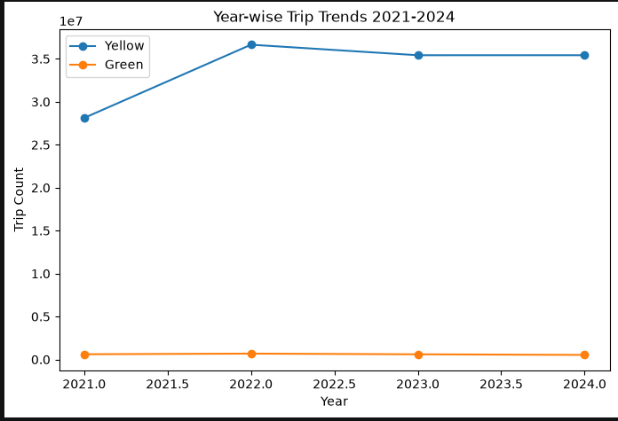
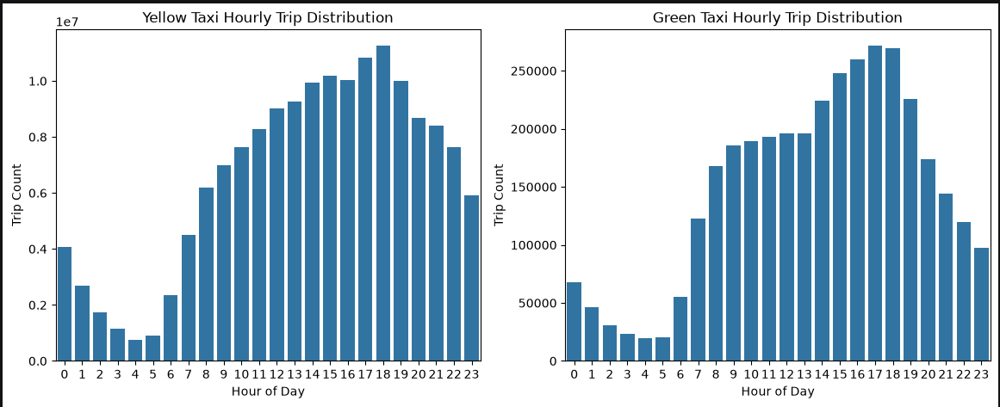
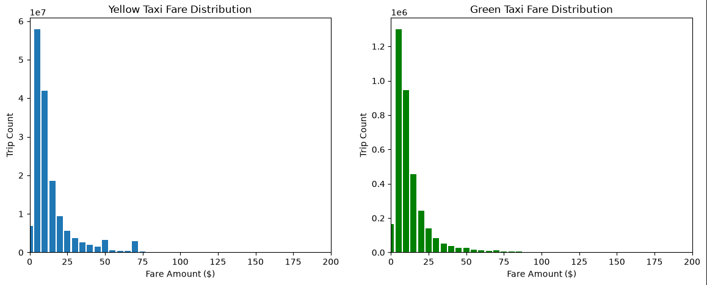

# NYC Taxi Data Pipeline
 
Data pipeline and EDA on NYC Yellow & Green taxi trips (2020–2024) using PySpark, SQLite and Seaborn.
 
This started as an exam project for Data Collection and Analysis (PGR215) at Kristiania. The idea was to build the whole thing end to end: get the data off the TLC website, clean it, store it, and then actually find something interesting in it. All 120 monthly files were used (5 years × 12 months × 2 taxi types).
 
The full write-up with every step explained is in [REPORT.md](REPORT.md). This README is the short version.
 
## Key results
 
- After cleaning: **158.4M yellow trips** and **3.5M green trips**. Yellow does about 45 times the volume of green.
- **9.3%** of yellow data and **30.3%** of green data was removed during cleaning. Same filters for both, so the difference is a real gap in recording quality, not a bug.
- The two fleets barely compete. **Not one** of the top 5 pickup zones is shared. Yellow is Upper East Side, JFK and Midtown, green is Harlem, Morningside Heights and Forest Hills.
- Average fares are almost the same ($16.17 yellow vs $15.02 green). Tips are not: $3.72 vs $2.94 on card payments, and yellow has a lot more card payments overall (79.8% vs 61.6%).
## How the pipeline works
 
**1. Scraping and downloading**
Download links are scraped from the TLC trip record page with `requests` and BeautifulSoup. The server blocked plain requests, so a browser `User-Agent` header was needed. Downloading 120 files in a row also got me rate limited (403s), so there's a 10 second pause between downloads. A check function runs first and only re-downloads files that are missing or corrupted, so re-running the notebook doesn't download everything again.
 
**2. Parquet → CSV**
Each file is converted with pandas and the row count is checked against the original, so a broken write gets caught.
 
**3. Cleaning with PySpark**
The yellow and green files don't have the same columns, so the datetime columns get renamed to neutral names early on. After that the same filters and the same SQL work on both. I added two derived columns, `time_spent` and `speed`. Speed turned out to be the most useful thing for finding bad records, like a 200 mile trip that took 40 seconds. Files are merged with `unionByName(allowMissingColumns=True)`, since columns change slightly across the five years.
 
**4. Saving to SQLite**
The cleaned data goes into `nyc_taxi.db` as 10 tables (one per fleet per year). Calling `.toPandas()` on a whole year ran out of memory, so it writes one month at a time instead. Like the download step, there's a check that skips the load if the database already has the right row counts.
 
**5. EDA and visualisation**
Analysis is done with Spark SQL on temp views. Only small aggregated results get pulled into pandas for plotting, never the full data.
 
## Charts
 
Trips per year, 2021–2024: yellow jumps in 2022 and then stays flat, green doesn't really move.
 

 
Trips by hour of day: both fleets have the same shape, quiet around 4 AM and busiest around 5–6 PM.
 

 
Fare distribution in $5 buckets: most trips are $5–15 for both fleets.
 

 
## Tech stack
 
Python, PySpark (SQL API), pandas, pyarrow, requests, BeautifulSoup, SQLite, matplotlib, seaborn
 
## How to run
 
1. Install Java (needed for Spark) and the Python packages:
```
   pip install pyspark pandas pyarrow requests beautifulsoup4 matplotlib seaborn
```
2. Open `Data_Collection_and_Analysis.ipynb` and run it top to bottom.
The data isn't included in this repo because the files are way too big for GitHub. The notebook downloads them itself from the [NYC TLC Trip Record Data](https://www.nyc.gov/site/tlc/about/tlc-trip-record-data.page) page. Heads up: the full run takes a while, and the Spark session is set up with 8 GB of driver memory.
 
## What I would add next
 
`PULocationID` is never joined with the TLC zone lookup table in the notebook, so the analysis works with raw zone IDs. That join would be the first thing to add.